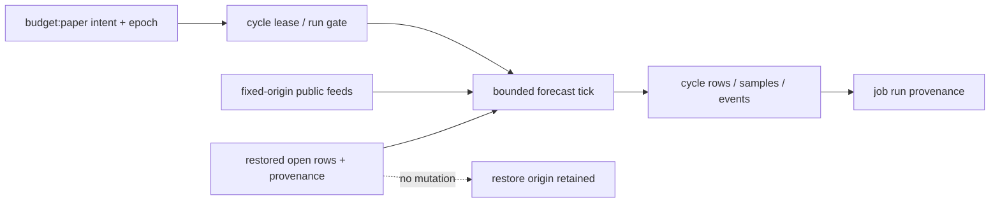

# Forecast-only cycle lane

Stage 2 of #243 adds the forecast lane to the existing [engine-cycle frame](engine-cycle.md). This is code availability, not activation. The schedule remains paused and committed mode remains dry. Paper execution and deployed staged-start evidence remain stages 3–4.

The lane requires schema-owner migration 0005; no runtime applies it. Later explicitly authorized activation must reconcile the restored seed, apply the migration through the schema-owner path, raise both control epochs for the schema event, and establish fresh persisted paper intent. This PR performs none of those effects.

Each tick reads persisted paper provider permissions, obtains public inputs, records qualified 15-second or unqualified minute observations, then resolves a bounded set of due rows. Production probability never reads performance, candidates, promotions or venue prices. Asks influence entry research only. Resolution uses the issuance venue and contract; unavailable, mismatched or unsupported results cannot substitute another venue.

The applied reason is forecast-run. Dry-run is unchanged. Paper records `mode-not-implemented` **only when no authority reader is wired**; since October 19, 2026 a wired paper lane reads the persisted authority and records that refusal instead — `paper-bundle-unavailable` for an otherwise valid recorded intent — and still runs nothing. See [the paper-engine port contract](paper-engine-port-contract.md) and [the engine-cycle runbook](engine-cycle.md#reason-codes). An expired writer cannot mutate forecasts; an opened run stays spent for retry/recovery evidence.

## Store topology

The unique asset/close cycle groups all observation identities. Overlay reads suppress the corresponding seed, preserving restoration without duplicate visible identities. New rows carry cycle-run origin; seeded overlays retain restore origin plus current mutation provenance.

See [stage-2 qualification](../validation/2026-10-10-forecast-stage2.md) for test boundaries, retention/diagnostic limitations and exact-head acceptance requirements.

## Authority and explicitly versioned adaptations

The current API's `services/platform-api/src/domain/budget-control.ts` documents provider-enable as an inert audited request until a funded-authority design exists. Its configure payload validates bounded scalar syntax, not a forecast provider/research policy schema. ADR-0013 fixes reading persisted pause/resume and epoch at the start of the run; it does not define a new forecast-config materializer. This lane therefore does not interpret configure/provider-enable scalars as provider execution or research authority. Restored paper provider flags only narrow which public-data observational targets are acquired after the current run gate; they do not grant authority to run, execute, or promote a model. No zero-budget research prohibition or live flag is inferred.

New forecast recording requires a valid current Polymarket 15-minute target and remains anchored to its close/slug/market identity. Kalshi-only acquisition cannot create a new forecast; existing restored Kalshi rows still resolve on their issuance venue. This is historical recording compatibility, not funded capability.

Candidate probability-family math retains the historical model-spec identities. Prospective candidate entries use a pure Kalshi observational compatibility allowlist intersected with enabled valid quotes. No execution capability, live flag or credential is imported. All available candidate probabilities remain recorded even when no eligible candidate entry exists. The DTO distinguishes the unconstrained best quote option from an admissible selected entry; probability and production paper qualification retain their original quote set and are never narrowed by candidate metadata. Archived promotions remain inert.

Issuance calibration uses compatible `calibration-replay-v1` fields, finite raw basis inputs and independently recomputed confidence/probability errors. Historical reconstruction never fabricates missing raw or confidence inputs. Non-control research candidates require issuance-exact probability and confidence replay errors at most 1e-12. Archived promotions remain inert.

## Restored-baseline reconciliation (November 13, 2026)

The reduced #243 acceptance requires the restored forecast/paper baseline to be reconciled **before the lane records anything**, and the excluded paper balances and orders to be unchanged. The forecast lane therefore reads one read-only snapshot of the restored tables through `ForecastStore.readBaseline()` after it holds the lease and before its first tick, and `services/engine-jobs/src/domain/forecast-baseline.ts` decides on it. A reconciled snapshot carries exactly one completed `engine.restore_run`, no open one, and every row in `engine.ledger_state`, `engine.ledger_order` and `engine.forecast_row` attributed to that run's `restore_run_id`. Nothing is counted by content, hash or sample: migration 0002 gives every restored row its `restore_run_id`, so the question is answered by counting attribution, and this check needs no migration, no new column and no new grant.

Anything else refuses the run with reason **`forecast-baseline-unreconciled`**, before `recordObservation` or `patchForecast` is reached, and the refusal is an ordinary complete run record: the outcome row is appended, job health updated and the lease released, so the run id stays spent and a retry does not re-enter the gate. The refusal reports every divergence it found, in a fixed order:

| Divergence | Meaning |
| --- | --- |
| `baseline-malformed` | The snapshot is unreadable — a missing field, a non-integer or negative count, an untrimmed or empty run id, digest or schema version. Unreadable fails closed; it never reads as clean. |
| `baseline-missing` | No completed restore run, so there is no baseline to reconcile against. |
| `baseline-ambiguous` | More than one completed restore run, so "the" baseline is not identified. |
| `baseline-incomplete` | A restore run is still open; the baseline may still be loading. |
| `paper-state-changed` | `engine.ledger_state` holds rows the baseline restore did not load. The excluded paper balances must be unchanged. |
| `paper-orders-changed` | `engine.ledger_order` holds rows the baseline restore did not load. The excluded paper orders must be unchanged. |
| `forecast-baseline-changed` | `engine.forecast_row` holds rows the baseline restore did not load, so the recording baseline is not the restored one. |
| `baseline-adoption-exceeds-restored` | More `engine.forecast_cycle_row` rows claim a restore origin than the baseline restored, so overlay attribution contradicts the baseline. |

Rows a previous cycle recorded (`engine.forecast_cycle_row.origin_run_id`) are **not** a divergence: after the first recording run they are expected, and the reconciled decision reports their count so an operator can tell a first run from a later one. The reason code is part of the closed `CYCLE_REASONS` set; this section is the document that names it, and `services/engine-jobs/src/cycle.test.ts` fails if a code loses its owning document.

Status: implemented and offline-tested only. `services/engine-jobs/src/forecast-baseline.test.ts` covers the decision table and the wiring against the in-memory stores; `services/engine-jobs/checks/forecast-postgres.mjs` exercises `readBaseline()` against a disposable loopback PostgreSQL 16 instance. No deployed run has executed this gate — the cycle schedule remains paused (`infra/stacks/engine-jobs/cycle.tfvars`) and the first recording run stays separately approved. See [the local qualification record](../validation/2026-11-13-forecast-baseline-reconciliation.md) for what was measured and what it does not cover.
